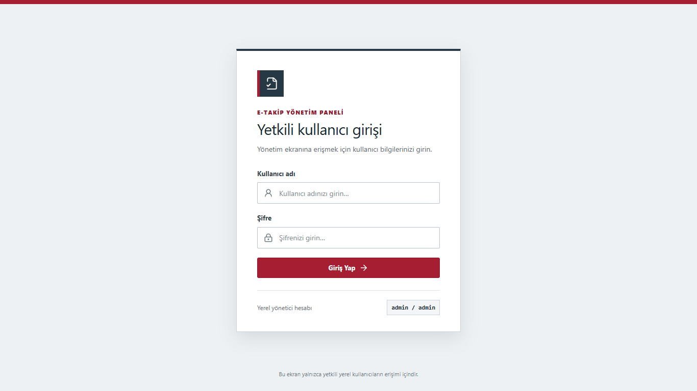
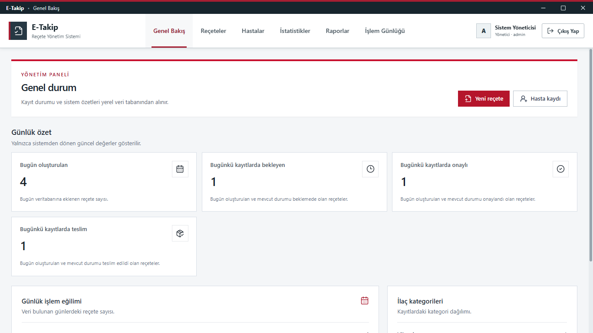
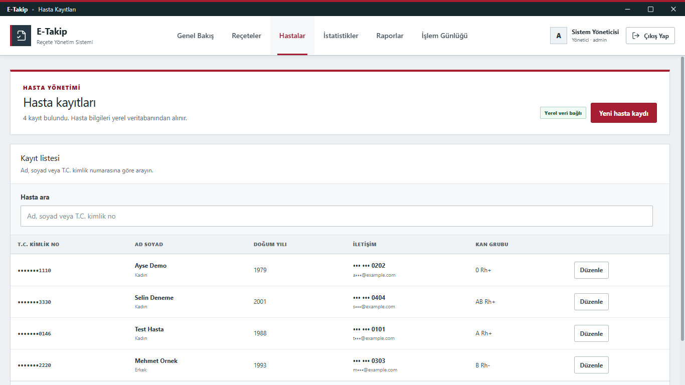
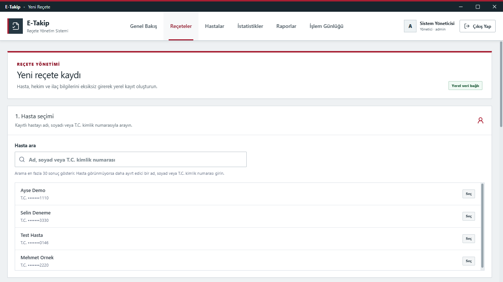
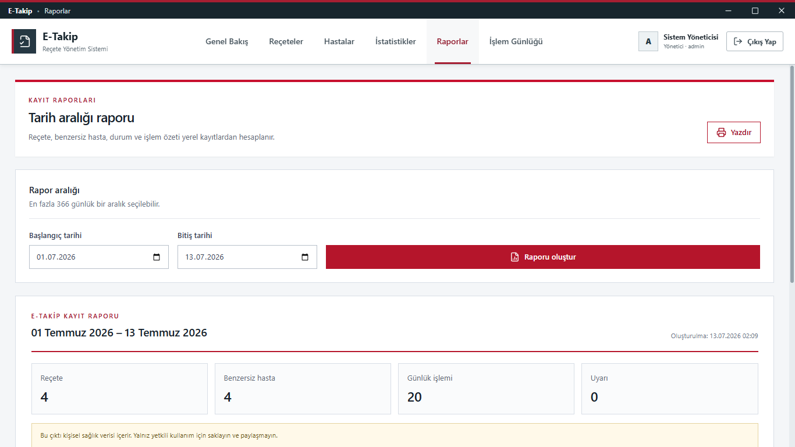
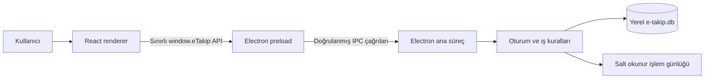

# e-Takip

[](https://github.com/mertcan-alan/e-takip/actions/workflows/ci.yml)
[](LICENSE)
[](https://github.com/mertcan-alan/e-takip/releases)

Yerel eczane iş akışlarını modellemek amacıyla geliştirilen, açık kaynaklı bir Electron masaüstü uygulaması.

> [!IMPORTANT]
> e-Takip bir **portfolyo ve iş akışı prototipidir**. e-Devlet Kapısı, Sağlık Bakanlığı, SGK, MEDULA, İTS veya başka bir kamu kurumu ya da sağlık sistemiyle bağlantısı yoktur. Tıbbi karar destek sistemi değildir ve gerçek hasta verisiyle üretim kullanımına hazır değildir.

## Proje hakkında

e-Takip; hasta kayıtları, reçete oluşturma, reçete durum takibi, tarih aralıklı raporlama ve denetlenebilir işlem geçmişi gibi temel eczane süreçlerini tek bir yerel masaüstü arayüzünde örnekler. Tasarım dili resmî hizmet portallarının sade ve erişilebilir yaklaşımından esinlenmiştir; herhangi bir resmî kurumu taklit etme veya temsil etme amacı taşımaz.

Uygulama ilk çalıştırmada yalnızca veritabanı şemasını oluşturur. Otomatik üretilmiş hasta, hekim, ilaç veya reçete kaydı içermez.

## Özellikler

- Yerel `admin / admin` demo girişi
- Hasta kaydı oluşturma, arama, görüntüleme ve düzenleme
- T.C. kimlik numarası biçim, kontrol hanesi ve benzersizlik denetimi
- Hasta, hekim ve birden fazla ilaç kalemiyle atomik reçete oluşturma
- Reçete listeleme, ayrıntı görüntüleme ve kontrollü durum güncelleme
- Tarih aralığına göre reçete, hasta, durum ve işlem özeti
- Filtrelenebilir, salt okunur işlem günlüğü
- Gerçek veritabanı kayıtlarından oluşturulan gösterge paneli ve istatistikler
- Boş, yükleniyor ve hata durumları için açık kullanıcı geri bildirimi
- Renderer sürecine doğrudan Node.js erişimi vermeyen sınırlı Electron köprüsü
- Tek uygulama örneği kilidi ve pencereye bağlı, süreli yerel oturum

## Ekran görüntüleri

Tüm ekran görüntüleri ayrı bir geçici profilde oluşturulan tamamen kurgusal ve maskelenmiş veriler içerir.



| Genel bakış | Hasta kayıtları |
|---|---|
|  |  |

| Yeni reçete | Raporlar ve günlükler |
|---|---|
|  |  |

## Teknoloji yığını

| Katman | Teknoloji |
|---|---|
| Masaüstü çalışma zamanı | Electron 43 |
| Kullanıcı arayüzü | React 18, React Router, Lucide React |
| Stil | Tailwind CSS 3 ve uygulamaya özel CSS |
| Derleme | Vite 8, electron-builder |
| Yerel veri | `sql.js` tabanlı SQLite veritabanı |
| Kod kalitesi | ESLint |

## Mimari



Ana süreç; oturum denetimini, giriş doğrulamasını, veri kurallarını ve veritabanı erişimini yönetir. Renderer yalnızca preload katmanında açıkça tanımlanan dar API yüzeyini kullanır. Reçete ve ilişkili kalemler transaction içinde kaydedilir; yarım kayıt bırakılmaz.

```text
src/
├── main/
│   ├── index.js              # Pencere yaşam döngüsü ve Electron güvenlik ayarları
│   ├── preload.js            # Sınırlı renderer API'si
│   └── db/
│       ├── database.js       # Yerel şema ve kalıcılık
│       └── handlers.js       # IPC, doğrulama ve iş kuralları
└── renderer/
    ├── App.jsx               # Rotalar ve oturum akışı
    ├── components/           # Ortak arayüz bileşenleri
    ├── context/              # İstemci durumu
    └── pages/                # Uygulama ekranları
```

## Kurulum ve çalıştırma

### Gereksinimler

- Node.js 22.12 veya üzeri
- Güncel npm
- Windows, macOS veya Linux geliştirme ortamı

```bash
git clone https://github.com/mertcan-alan/e-takip.git
cd e-takip
npm install
npm run dev
```

Demo hesabı:

```text
Kullanıcı adı: admin
Şifre: admin
```

Bu sabit hesap yalnızca yerel geliştirme ve tanıtım içindir.

Tarayıcı arayüzünü masaüstü köprüsü olmadan önizlemek için:

```bash
npm run vite:dev
```

Tarayıcı önizlemesinde Electron veri köprüsü bulunmadığından kayıt işlevleri çalışmaz ve ilgili ekranlar boş durum gösterebilir.

Dağıtılabilir masaüstü paketi üretmek için:

```bash
npm run electron:build
```

## Doğrulama

Projede Node.js yerleşik test çalıştırıcısıyla çalışan 12 kaynak, güvenlik ve veri sözleşmesi testi bulunur. Değişiklik göndermeden önce aşağıdaki kontroller çalıştırılmalıdır:

```bash
npm run lint
npm test
npm run build
npm audit
```

GitHub Actions aynı kontrolleri Node.js 22 üzerinde otomatik çalıştırır. Masaüstü akışları için giriş, hasta oluşturma, reçete oluşturma, durum güncelleme, raporlama ve işlem günlüğü ayrıca uçtan uca doğrulanmalıdır.

## Veri saklama

Uygulama verileri Electron kullanıcı verisi dizinindeki `e-takip.db` dosyasında yerel olarak tutulur. Depoda gerçek veya örnek hasta verisi bulunmaz.

`npm run db:clean` varsayılan olarak yalnız hedef yolu gösteren güvenli bir dry-run çalıştırır. Gerçek silme için komuta `-- --yes` eklenmesi gerekir; bu işlem geri alınamaz ve gerçek kayıt bulunan bir ortamda kullanılmamalıdır.

## Güvenlik kapsamı ve bilinen sınırlar

Mevcut korumalar:

- Electron `contextIsolation` ve sandbox etkin, renderer Node.js erişimi kapalıdır.
- Veritabanı çağrıları başarılı girişle oluşturulan ve renderer'a açılmayan geçici oturum belirtecine bağlıdır.
- Oturum pencereye bağlıdır, sürelidir ve başarısız giriş denemeleri geçici olarak sınırlandırılır.
- İkinci uygulama örneğinin aynı veritabanına eş zamanlı yazması engellenir.
- Dış yönlendirmeler HTTP/HTTPS şemalarıyla sınırlandırılır.
- T.C. kimlik numarası temel algoritmik kurallarla doğrulanır.

Üretim kullanımı öncesi çözülmesi gerekenler:

- Sabit demo hesabının kaldırılması ve güçlü parola hashleme
- Kullanıcı bazlı kimlik doğrulama, rol/yetki modeli ve tercihen çok faktörlü doğrulama
- Diskte veritabanı ve yedek şifrelemesi; güvenli anahtar yönetimi
- Doğrulanmış yedekleme, geri yükleme, migration ve güncelleme/rollback süreçleri
- Veri saklama, silme, dışa aktarma ve erişim politikaları
- Kod imzalama ve güvenli otomatik güncelleme
- Bağımsız güvenlik testi, tehdit modellemesi ve olay müdahale süreci
- Yetkili hukuk ve bilgi güvenliği uzmanlarınca KVKK ve ilgili mevzuat değerlendirmesi

Sağlık verileri özel nitelikli kişisel verilerdir. Bu proje **KVKK uyumlu olduğunu iddia etmez**. Ayrıntılı bildirim süreci için [SECURITY.md](SECURITY.md) dosyasına bakın.

## İlaç ve tıbbi bilgi sınırı

Uygulama tıbbi öneri üretmez. Etkileşim uyarıları yalnızca yerel `drug_interactions` tablosunda önceden kayıtlı eşleşmelere dayanır; doğrulanmış, eksiksiz veya güncel bir ulusal ilaç veri kaynağı sunulmaz. Herhangi bir uyarının bulunmaması bir reçetenin güvenli olduğu anlamına gelmez.

## Yol haritası

- [ ] Demo ve production yapılandırmalarını kesin olarak ayırma
- [ ] Güvenli kullanıcı deposu ve rol tabanlı yetkilendirme
- [ ] Şifreli veritabanı ve doğrulanabilir yedek/geri yükleme
- [x] Kaynak, güvenlik ve veri sözleşmesi testleri
- [ ] Veritabanı entegrasyon ve Electron uçtan uca testleri
- [ ] Veritabanı şema migration sistemi
- [ ] Erişilebilirlik ve klavye kullanım denetimi
- [ ] Kod imzalı sürümler ve güvenli güncelleme kanalı
- [ ] Gerçek eczacı geri bildirimiyle kullanıcı araştırması
- [ ] Mevzuat ve güvenlik incelemesinden sonra kontrollü pilot değerlendirmesi

MEDULA, İTS veya başka bir resmî sisteme entegrasyon bu deponun mevcut kapsamı değildir. Böyle bir çalışma ancak yetkili erişim, güncel resmî dokümantasyon, uygun sözleşmeler ve gerekli onaylarla ayrı olarak ele alınmalıdır.

## Katkıda bulunma

Katkılar memnuniyetle karşılanır. Başlamadan önce [CONTRIBUTING.md](CONTRIBUTING.md) ve güvenlik bildirimleri için [SECURITY.md](SECURITY.md) dosyalarını okuyun. Hata raporlarında, ekran görüntülerinde ve test verilerinde gerçek kişisel veya sağlık verisi kullanmayın.

## Lisans

Bu proje [MIT Lisansı](LICENSE) ile sunulur. Lisans, yazılımı belirli bir amaca uygun veya üretim kullanımına hazır hâle getiren bir garanti sağlamaz.

## Sorumluluk reddi

e-Takip eğitim, portfolyo ve prototipleme amacıyla geliştirilmiştir. Reçete doğrulama, tanı, ilaç güvenliği, mevzuat uyumu veya klinik karar verme aracı değildir. Yazılım “olduğu gibi”, herhangi bir açık ya da örtülü garanti olmaksızın sunulur. Proje adı ve tasarımı herhangi bir kamu kurumu adına onay, bağlantı veya temsil ifade etmez.
